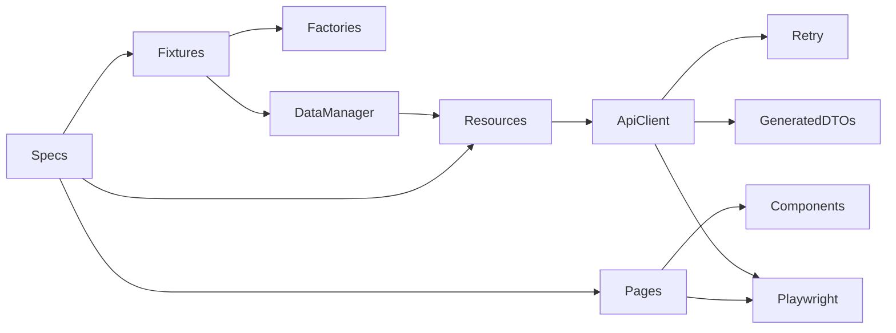

# Toolshop TypeScript QA Automation Portfolio

[](https://github.com/Khvoya/toolshop-playwright-portfolio/actions/workflows/ci.yml)

Production-style **TypeScript + Playwright** automation for the Toolshop customer and administrator journeys. The project demonstrates generated Swagger DTOs, typed API resource clients, reusable UI components, API-driven test data, controlled retries, Allure diagnostics, Docker execution, GitHub Actions, and an AI-ready contribution contract.

## Application under test

[Practice Software Testing](https://practicesoftwaretesting.com/) is an Angular storefront with a Laravel REST API. This project targets Sprint 5 and runs it locally:

- UI: `http://localhost:4200`
- API and Swagger UI: `http://localhost:8091/api/documentation`
- Swagger JSON used for generation: `http://localhost:8091/docs?api-docs.json`

The upstream application is cloned at pinned commit `ae7caecb811dd8952c09d997e69be7cb946ecd44` into ignored `.runtime/` storage. Its source is **not vendored**. See the [upstream repository](https://github.com/testsmith-io/practice-software-testing): this portfolio contains independent tests only.

## Coverage

There are **36 tests**: 16 API, 10 customer UI, 3 Admin UI, 2 E2E, and 5 framework self-tests. Chromium is the supported browser.

| Suite    | Scenarios                                                                                                                        |
| -------- | -------------------------------------------------------------------------------------------------------------------------------- |
| API      | Authentication, registration validation, catalog contracts, pagination, search, missing records, carts, favorites, authorization |
| UI       | Catalog and product details, search, registration, login/logout, invalid login, cart totals, favorites, checkout validation      |
| Admin UI | Isolated product create, full-form update, and delete with independent API verification                                          |
| E2E      | UI login through purchase and API verification; API-prepared user/cart through UI checkout                                       |
| Self     | Retry behavior, sensitive-data redaction, factory uniqueness                                                                     |

Every application spec uses descriptive `test.step` blocks for Arrange/Act/Assert. Smoke tests are tagged `@smoke`, rejection scenarios `@negative`.

## Design patterns

| Pattern               | Implementation                                                                                          |
| --------------------- | ------------------------------------------------------------------------------------------------------- |
| Page Object           | `src/ui/pages/` exposes business actions and web-first locators                                         |
| Component Object      | Navigation, product card, pagination, toast, and admin product form in `src/ui/components/`             |
| API Client Wrapper    | `ApiClient` wraps Playwright `APIRequestContext`; resource clients hide URLs and payload/status details |
| Generated DTOs        | `swagger-typescript-api` generates `src/api/generated/Api.ts` from the pinned local Swagger document    |
| Domain projections    | `src/api/models.ts` makes business-required fields explicit where upstream Swagger marks them optional  |
| Factory               | `UserFactory`, `ProductFactory`, and `CheckoutDataFactory` generate unique valid DTOs                   |
| Fixture preconditions | `registeredUser`, `product`, `cart`, `pageWithCart`, and page fixtures build isolated state through API |
| Cleanup               | `TestDataManager` tracks users, carts, favorites, and products and removes them in dependency order     |
| Controlled retry      | Transient safe-request retry in `ApiClient`; one Playwright retry only in CI                            |
| Business steps        | `test.step` in specs and nested resource actions                                                        |



## Prerequisites

- Node.js 20.17 or newer; CI uses Node.js 22
- npm 10 or newer
- Docker Desktop or Docker Engine with Compose
- Java 17 or newer to render Allure HTML locally
- Optional: [GitHub CLI](https://cli.github.com/) for workflow operations

## Setup

```bash
cp .env.example .env
npm ci
npx playwright install chromium
npm run app -- start
```

On Windows PowerShell, use `Copy-Item .env.example .env`. The admin credentials in `.env.example` belong only to the seeded local application and are used for Admin UI and cleanup. Do not put real credentials into `.env.example`.

Application commands:

```bash
npm run app -- status
npm run app -- logs
npm run app -- stop
npm run app -- reset  # destroys this application's local Docker volumes
```

## Run tests

```bash
npm test
npm run test:api
npm run test:ui
npm run test:admin
npm run test:e2e
npm run test:self
npm run test:smoke
```

Two workers run by default. Test-level retries are disabled locally: investigate failures rather than hiding them. Set `TOOLSHOP_HEADLESS=false` in `.env` for headed debugging.

Generate API DTOs while the local application is running:

```bash
npm run generate:api
```

Do not edit the generated file manually. The CI API job fails when generated contracts are stale.

## Allure and diagnostics

Every run writes results to `artifacts/allure-results/` and a Playwright HTML report to `artifacts/playwright-report/`.

```bash
npm run allure:generate
npm run allure:open
npx playwright show-report artifacts/playwright-report
```

Failed UI tests include a screenshot, video, trace ZIP, last URL, and browser errors. API requests/responses are attached with passwords, tokens, and payment secrets recursively redacted. Inspect a trace with:

```bash
npx playwright show-trace artifacts/test-results/<test-name>/trace.zip
```

## Docker test runner

Start the application first, then build and run the independent test container:

```bash
docker compose -f compose.tests.yml build
docker compose -f compose.tests.yml run --rm tests --project=api
docker compose -f compose.tests.yml run --rm tests --project=ui
docker compose -f compose.tests.yml run --rm tests --project=admin
docker compose -f compose.tests.yml run --rm tests --project=e2e
docker compose -f compose.tests.yml down --remove-orphans
```

The runner uses Playwright image `v1.65.0-noble`, matching `@playwright/test`. Results are mounted into `artifacts/`. `host.docker.internal` is configured for Docker Desktop and Linux CI. An `alpine/socat` sidecar shares its network namespace with the test runner so Angular's `localhost:8091` API calls reach the host application correctly.

## Quality gates

```bash
npm run quality
npx playwright test --list
npm audit
npm run test:self
```

Quality includes Prettier, ESLint strict type-aware rules, and strict TypeScript with no emitted build output.

## GitHub Actions and GitHub CLI

`.github/workflows/ci.yml` runs quality gates and an API/UI/Admin/E2E matrix. Pull requests execute smoke tests; pushes to `main` and manual dispatch execute all application tests. CI alone enables one diagnostic Playwright retry. Allure results and failure diagnostics are retained as artifacts; no GitHub Pages deployment is required.

Authenticate once with `gh auth login`, then:

```bash
npm run gh:ci -- workflows
npm run gh:ci -- runs
npm run gh:ci -- dispatch main
npm run gh:ci -- watch <run-id>
npm run gh:ci -- download <run-id>
```

See [docs/CI.md](docs/CI.md) for artifact and operational details.

## AI-assisted test generation

Universal instructions live in `AGENTS.md` and `docs/AI_TEST_GENERATION.md`. Templates under `docs/templates/` mirror real specs. Agents must reuse fixtures, generated DTOs, domain models, pages, components, and resource clients, then run the documented quality gates and relevant real suite.

## Project map

```text
src/
  api/
    generated/  Swagger DTOs; generated, not hand-edited
    resources/  Endpoint-specific typed clients
    client.ts   Transport, redaction, status checks
    retry.ts    Controlled exponential retry
    models.ts   Strict business-domain projections
  fixtures/     API and browser composition roots
  factories/    Unique DTO generators
  services/     Test-data lifecycle manager
  ui/
    pages/      Page Objects
    components/ Root-scoped Component Objects
  config/       Validated environment settings
tests/
  api/          API integration and contract specs
  ui/           Chromium customer UI specs
  admin/        Isolated administrator product CRUD
  e2e/          Cross-layer customer journeys
  self/         Framework tests without the application
scripts/        App, Swagger generation, and GitHub CLI automation
docs/           Architecture, data, CI, AI rules, and templates
```

## Scope and limitations

- Customer and Admin Products journeys are in scope; visual, accessibility, performance, and security suites are intentionally excluded.
- Checkout uses cash on delivery. External payment providers are not required.
- Generated orders are business history; `npm run app -- reset` restores a clean local database when needed.
- The public hosted demo is not a test target, so shared-state instability and external availability do not affect the suite.
- TypeScript types do not validate runtime JSON by themselves; contract tests and strict domain projections define the tested response expectations.
